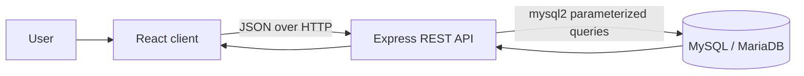
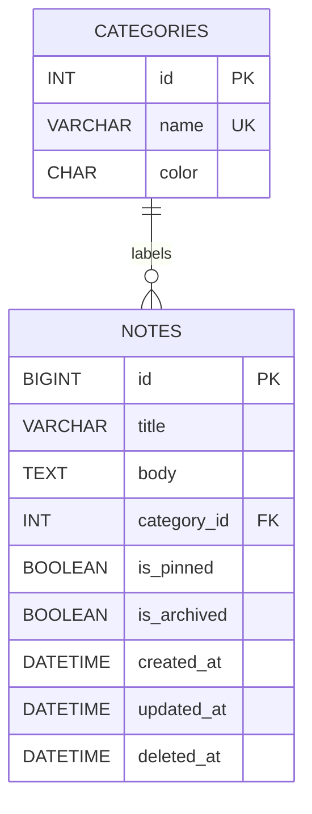

# Little Notes — Project Documentation

**Project:** Little Notes, a notes and task organizer
**Stack:** React, Node.js/Express, MySQL/MariaDB
**Documentation updated:** October 24, 2026

## 1. Project overview

Little Notes is a responsive note and task organizer. Users can create, read, edit, search, sort, categorize, pin, archive, restore, and move notes to Trash. The interface uses a soft pastel palette, paper-plane artwork, a navigation drawer, and a persistent light/dark theme choice.

The React client sends JSON requests to an Express REST API. The API validates requests and reads or updates the MySQL database using parameterized queries. Categories are stored separately from notes and linked through a foreign key.

## 2. Features

- Create notes with a title, body, and Work, Personal, or Urgent category.
- View active, archived, or trashed notes.
- Search title/body text, filter by category, and sort by updated time, created time, or title.
- Pin active notes, archive/unarchive notes, and restore notes from Trash.
- Soft-delete notes by setting `deleted_at` so they can be restored.
- Show loading, empty, filtered-empty, validation, request-error, and retry states.
- Persist the dark-mode selection in browser local storage.

## 3. Architecture



### Main folders

| Folder | Contents |
|---|---|
| `frontend/` | React UI, CSS, Vite configuration, and static artwork. |
| `backend/` | Express server, API routes, database pool, middleware, and ignored local `.env`. |
| `database/schema/` | Database and table DDL. |
| `database/seed/` | Work, Personal, and Urgent starter categories. |
| `database/migrations/` | SQL changes for existing local data, including category colors. |
| `database/examples/` | Query patterns and a rollback-safe transactional CRUD example. |
| `database/users/` | Example app-account and GRANT/REVOKE SQL. |
| `database/backups/` | Backup and recovery instructions; database dump files should be kept elsewhere. |
| `documentation/` | Setup, architecture, API, database, and operational documentation. |

## 4. Setup and run instructions

### Prerequisites

- Node.js 20 or newer and npm.
- XAMPP MySQL/MariaDB running locally (the project was developed with XAMPP MariaDB 10.4.32; MySQL 8.0.16+ is also supported by the schema constraints used here).
- A MySQL/MariaDB account that can access the project database.

### Create the database

In phpMyAdmin or a MySQL client, run these scripts in order:

1. `database/schema/001-create-schema.sql`
2. `database/seed/001-seed-categories.sql`

The schema script creates and selects the `sticky_notes` database. The seed script is safe to rerun and updates the colors for the three standard categories. For an existing database that needs the latest palette, `database/migrations/002-vibrant-category-colors.sql` is available.

### Configure the backend

From PowerShell:

```powershell
Copy-Item backend/.env.example backend/.env
```

Edit `backend/.env` locally with the correct connection values. Expected keys:

| Variable | Default/example | Purpose |
|---|---|---|
| `PORT` | `3001` | Express API port. |
| `DB_HOST` | `127.0.0.1` | Local database host. |
| `DB_PORT` | `3306` | Local MySQL/MariaDB port. |
| `DB_NAME` | `sticky_notes` | Project database. |
| `DB_USER` | `sticky_app` | Application connection user. |
| `DB_PASSWORD` | Set locally | Application user's password. |
| `CLIENT_ORIGIN` | Optional; backend default is `http://localhost:5173` | Browser origin allowed by CORS. |

Never commit `.env`, passwords, or database exports. `.gitignore` excludes local environment files, dependencies, build output, caches, and logs. Keep an administrator account for schema changes and recovery rather than using it for the running app.

### Install and start

Open two terminals from the project folder.

**Terminal 1 — backend:**

```powershell
Set-Location backend
npm install
npm run dev
```

**Terminal 2 — frontend:**

```powershell
Set-Location frontend
npm install
npm run dev
```

Open the local URL printed by Vite (normally `http://localhost:5173`; Vite may choose another port if that one is busy). The Vite development server forwards `/api` requests to `http://localhost:3001`.

Check `http://localhost:3001/api/health`. A working connection returns:

```json
{ "status": "ok", "database": "connected" }
```

If the database is stopped or credentials are incorrect, the health route returns HTTP 503 with a safe message. Review the backend terminal for the error code; do not expose credentials when sharing logs.

## 5. Data model and data dictionary

### Entity relationship



### `categories`

| Column | Type | Rules | Purpose |
|---|---|---|---|
| `id` | `INT UNSIGNED` | Primary key, auto-increment, not null | Category identifier. |
| `name` | `VARCHAR(30)` | Not null, unique | Category label. |
| `color` | `CHAR(7)` | Not null; check requires `#` plus six hexadecimal digits | Category display color. |

### `notes`

| Column | Type | Rules | Purpose |
|---|---|---|---|
| `id` | `BIGINT UNSIGNED` | Primary key, auto-increment, not null | Note identifier. |
| `title` | `VARCHAR(120)` | Not null; check rejects whitespace-only titles | Short note/task name. |
| `body` | `TEXT` | Not null | Note details. |
| `category_id` | `INT UNSIGNED` | Not null; foreign key to `categories.id` | Note category. |
| `is_pinned` | `BOOLEAN` | Not null, default false | Whether an active note is pinned. |
| `is_archived` | `BOOLEAN` | Not null, default false | Whether a note is archived. |
| `created_at` | `DATETIME` | Not null, default current timestamp | Creation time. |
| `updated_at` | `DATETIME` | Not null, default current timestamp; updates automatically | Last modification time. |
| `deleted_at` | `DATETIME` | Nullable, default null | Soft-delete time; null means not in Trash. |

### Relationships, constraints, and indexes

- One category can label many notes; each note must reference one existing category.
- The category foreign key uses `ON UPDATE CASCADE` and `ON DELETE RESTRICT`, protecting notes from losing their category.
- `uq_categories_name` prevents duplicate category names. `chk_categories_color` and `chk_notes_title_not_blank` enforce basic data rules in the database.
- `idx_notes_active_recent (is_archived, deleted_at, updated_at)` supports common state/recent-note filtering.
- `idx_notes_category_recent (category_id, is_archived, deleted_at, updated_at)` supports category-scoped state/recent-note filtering.
- Title/body substring search uses `LIKE '%term%'`; the current B-tree indexes do not accelerate that substring predicate.

## 6. API reference

Base URL: `http://localhost:3001/api` (the frontend uses the Vite `/api` proxy).

| Method | Path | Behavior |
|---|---|---|
| `GET` | `/health` | Checks that the API can query the database. |
| `GET` | `/categories` | Lists category IDs, names, and colors. |
| `GET` | `/notes` | Lists notes. Supports `view`, `q`, `categoryId`, `sort`, `order`, `limit`, and `offset`. |
| `GET` | `/notes/:id` | Reads one non-deleted note. |
| `POST` | `/notes` | Creates a note from `{ "title": "...", "body": "...", "categoryId": 1 }`. |
| `PUT` | `/notes/:id` | Replaces a note's title, body, and category. |
| `PATCH` | `/notes/:id` | Updates `isPinned` and/or `isArchived` booleans. |
| `DELETE` | `/notes/:id` | Soft-deletes by setting `deleted_at`; pinned notes must be unpinned first (HTTP 409 otherwise). |
| `POST` | `/notes/:id/restore` | Restores a soft-deleted note. |

List query values:

- `view`: `active` (default), `archived`, or `trash`.
- `q`: title/body substring search (up to 200 characters).
- `categoryId`: positive category ID.
- `sort`: `updatedAt` (default), `createdAt`, or `title`.
- `order`: `asc` or `desc` (default `desc`). Active notes sort pinned first.
- `limit`: 1–100 (default 50); `offset`: zero or greater (default 0).

Responses are JSON. Invalid fields/query values return HTTP 400 or 422; a missing note returns 404; attempting to move a pinned note to Trash returns HTTP 409; malformed JSON returns 400; request bodies over 1 MB return 413; unexpected server errors return a generic HTTP 500 message. The backend logs the error code/name without returning SQL details to the browser.

## 7. Database query examples

`database/examples/001-query-patterns.sql` contains examples of:

- An `INNER JOIN` between notes and categories.
- Category plus title/body search filters.
- `UNION ALL` across active, archived, and trashed notes.
- `LEFT JOIN` aggregates by category and state.
- A correlated `EXISTS` subquery for categories containing pinned active notes.
- `EXPLAIN` and `SHOW INDEX` for a category/recent-notes access path.

`database/examples/002-transactional-crud-example.sql` performs INSERT, SELECT, UPDATE, and DELETE inside a transaction, then rolls it back so no sample row remains. Run it as one script in one SQL session.

In the local XAMPP run, `EXPLAIN` selected `idx_notes_category_recent` (`type=ref`, estimated `rows=1`, `Using where`). `SHOW INDEX` confirmed the two declared composite indexes. Query plans can change with data volume and database version, so treat those values as the observed local result, not a guarantee for every environment.

## 8. Security, permissions, and recovery

- API values are passed through `mysql2` prepared statements. Query sort columns are selected from a fixed allowlist; filter values are parameterized.
- Keep database passwords in the ignored local `backend/.env`, not in source files or shared logs.
- `database/users/001-create-app-user.example.sql` shows a least-privilege grant pattern for reading categories and reading or modifying notes. Review the host name and account details before applying it.
- `database/users/002-grant-revoke-example.sql` shows how to grant and revoke a temporary DELETE privilege. Run it only in a database where you control the account and understand the effect.
- Backup and restore steps are in `database/backups/README.md`. Keep SQL dumps outside Git and test recovery in a separate database before relying on a backup.

## 9. Verification record

Local and deployed verification:

- The frontend production build completed successfully.
- Backend syntax checks passed for the server, note/category routes, and error middleware.
- The live health endpoint returned `ok` and `database: connected`.
- 15 live API checks passed for the main note lifecycle, organization actions, validation, and unknown-route handling.
- Malformed JSON returned HTTP 400; a request above the 1 MB limit returned HTTP 413.
- Temporary API test data was removed and checked for leftover marker rows.
- On October 24, 2026, the deployed API health endpoint returned `status: ok` and `database: connected`.
- The deployed frontend supports the full note lifecycle through the API.

## 10. Known limits and deferred work

- Search is substring matching and is not accelerated by the ordinary B-tree indexes; evaluate FULLTEXT only if a larger dataset justifies it.
- The current public deployment has no authentication, so all visitors share one notes collection. Add accounts and per-user authorization before using it for personal or multi-user data.
- Offline synchronization and real-time collaboration are not implemented.

## Related files

- Query examples: [`../database/examples/001-query-patterns.sql`](../database/examples/001-query-patterns.sql)
- Transactional CRUD example: [`../database/examples/002-transactional-crud-example.sql`](../database/examples/002-transactional-crud-example.sql)
- Database backup and recovery notes: [`../database/backups/README.md`](../database/backups/README.md)
